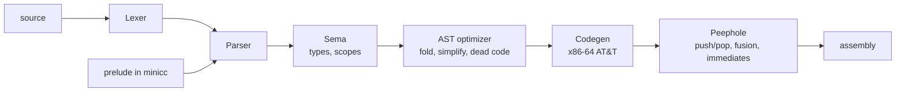

# minicc

[](https://github.com/shaurya-10000/cpp-compiler/actions/workflows/ci.yml)

A small C-like compiler written in C++17 that turns source files into **x86-64 Linux assembly** (AT&T syntax).
No dependencies and no LLVM: it has its own lexer, parser, type checker, optimizer and code generator, and the output assembles with plain `gcc`.

```c
struct Node { int value; struct Node* next; };

int sum(struct Node* n) {
    int total = 0;
    while (n) { total += n->value; n = n->next; }
    return total;
}

int main() {
    struct Node a; struct Node b;
    a.value = 40; a.next = &b;
    b.value = 2;  b.next = 0;
    print_int(sum(&a));   // 42
    return 0;
}
```

## Build and run

Requires CMake 3.16+ and a C++17 compiler. Running the output needs Linux x86-64 and `gcc` (used only as the assembler and linker).

```bash
cmake -S . -B build -DCMAKE_BUILD_TYPE=Release
cmake --build build

./build/minicc --compile prog.cpp -o prog.s
gcc prog.s -o prog
./prog
```

## Command line

| Option | Meaning |
|---|---|
| `--compile <file>` | Emit assembly on stdout (or to the file given with `-o`) |
| `--dump-tokens <file>` | Print the token stream |
| `--dump-ast <file>` | Print the parsed AST |
| `--dump-typed <file>` | Print the AST after type checking, with the type of every expression |
| `--dump-opt <file>` | Print the AST after optimization |
| `-O0`, `-O1` | Optimizer off / on (default `-O1`) |
| `--stats` | Print what each optimizer pass did |
| `--version`, `--help` | Version and usage |

Errors point at the source:

```
prog.cpp:1:22: error: expected expression (got ';')
 1 | int main() { int x = ; return 0; }
   |                      ^
```

## Architecture



| File | Role |
|---|---|
| `src/lexer.*`, `tokens.h` | Tokens, comments, literals (int, double, char, string) |
| `src/parser.*`, `ast.h`, `ast_ext.h` | Recursive-descent parser, C operator precedence |
| `src/types.h` | Type model: scalars, pointers of any depth, structs |
| `src/sema.*` | Scopes, type checking, implicit conversions, call checking |
| `src/optimizer.*` | Constant folding, algebraic simplification, branch resolution, dead-code removal |
| `src/codegen.*` | Stack-machine code generator (System V calling convention) |
| `src/peephole.*` | Pattern rewrites over the generated assembly |
| `src/prelude.h` | `print_double` and helpers, written in minicc itself |
| `src/ast_dump.*` | `--dump-*` pretty printer |

## The language

- **Types:** `int` (64-bit), `char`, `bool`, `double`, `void`, pointers (`int*`, `char**`, `void*`), `struct`
- **Declarations:** locals, globals with constant initializers, arrays (`int a[5] = {1,2,3};`, `int a[] = {...}`, `char s[] = "text";`), prototypes and forward declarations
- **Statements:** `if` / `else if` / `else`, `while`, `do`-`while`, `for`, `break`, `continue`, `return`, blocks with scoping
- **Expressions:** all C arithmetic, bitwise, shift, comparison and logical operators with C precedence, short-circuit `&&` and `||`, `?:`, assignment and compound assignment, `++` / `--`, casts, `sizeof(type)`, `&`, `*`, `[]`, `.`, `->`, pointer arithmetic
- **Conversions:** implicit numeric conversions, `0` as the null pointer, `void*` to and from any pointer; everything else needs a cast
- **Built-ins:** `print_int(int)`, `print_char(int)`, `print_str(char*)`, `print_double(double)`

## Code generation

- Every value is computed in `%rax`; binary operators push the left operand and pop it into `%rcx`.
- Arguments follow the System V ABI: six in registers, the rest on the stack, with the stack kept 16-byte aligned at every call.
- Frames are sized exactly per function. Doubles travel as raw 64-bit patterns and are computed with SSE2 (`addsd`, `ucomisd`, ...).
- I/O uses raw `write` syscalls, so the output does not link against libc.

## Optimizer

`-O1` runs two layers:

1. **AST level:** constant folding with the exact runtime semantics (64-bit wraparound, arithmetic shift), identities such as `x+0`, `x*1`, `x*0`, constants moved to the right, constant `if` / `while` / `for` conditions resolved, unreachable statements and pure expression statements removed.
2. **Assembly level (peephole):** `push` / `pop` pairs become register moves, compare + `setcc` + `test` + `jcc` fuse into one conditional jump, register operands become immediates, multiplications by powers of two become shifts, redundant store/reload pairs and dead code after `jmp` / `ret` disappear.

Run `./build/minicc --stats --compile prog.cpp > /dev/null` to see the counts, or `bash bench/bench.sh` to compare `-O0` and `-O1`.

## Tests

```bash
bash tests/run_tests.sh ./build/minicc -O0     # whole suite, optimizer off
bash tests/run_tests.sh ./build/minicc -O1     # same programs, optimizer on
bash tests/run_diag_tests.sh ./build/minicc    # error message formatting and CLI
ctest --test-dir build                         # runs the above
```

- `tests/*.cpp` are programs whose output is compared with `tests/<name>.expected`.
- `tests/errors/*.cpp` must be rejected; the first line (`// ERROR: ...`) is the expected message.
- `tests/asm/*.cpp` check that optimizations actually fire (`// ASM-HAS:`, `// ASM-NOT:`) and still print the right output.

Running every program at both `-O0` and `-O1` means a miscompile by an optimization shows up as a difference.

## Limitations

- Linux x86-64 only (System V ABI, raw syscalls).
- Structs cannot be copied, passed or returned by value; use pointers. Struct members cannot be arrays.
- No preprocessor, `#include`, `enum`, `union`, `typedef`, `switch`, `static`, function pointers or multi-dimensional arrays.
- Doubles are passed in integer registers, so minicc code cannot call C math functions directly.
- There is no standard library beyond the four built-ins.