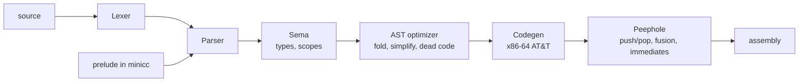

# minicc

[](https://github.com/shaurya-10000/cpp-compiler/actions/workflows/ci.yml)


**A C-like compiler written from scratch in C++17.** It reads a C subset and emits x86-64 assembly that plain `gcc` can assemble and link. No LLVM, no parser generators, no dependencies: the lexer, parser, type checker, optimizer, code generator and peephole pass are all hand-written.

## Highlights

- **Real language features:** `int`/`char`/`bool`/`double`, pointers of any depth, arrays, `struct`, globals, recursion, more than six call arguments, `?:`, compound assignment, `++`/`--`, bitwise and shift operators.
- **Static type checking** with implicit conversions, pointer arithmetic scaled by element size, and clear errors (`file:line:col`, source line and caret).
- **Two-layer optimizer:** constant folding and dead-code removal on the AST, then a peephole pass over the generated assembly.
- **Standard calling convention:** System V ABI with correct 16-byte stack alignment, so compiled functions follow the same rules as gcc's.
- **90+ automated tests** running in CI at both `-O0` and `-O1`, so an optimizer miscompile shows up as a difference between the two runs.
- **No libc:** output programs talk to the kernel with raw `write` syscalls.

## Quick start

Requires CMake 3.16+ and a C++17 compiler. Running the output needs Linux x86-64 and `gcc` (used only as assembler and linker).

```bash
cmake -S . -B build -DCMAKE_BUILD_TYPE=Release
cmake --build build

./build/minicc --compile examples/list.cpp -o list.s   # or any file of your own
gcc list.s -o list
./list
```

A small program:

```c
struct Node { int value; struct Node* next; };

int sum(struct Node* n) {
    int total = 0;
    while (n) { total += n->value; n = n->next; }
    return total;
}

int main() {
    struct Node a; struct Node b;
    a.value = 40; a.next = &b;
    b.value = 2;  b.next = 0;
    print_int(sum(&a));   // prints 42
    return 0;
}
```

## What the optimizer does

Each row below is checked by a test in `tests/asm`, which asserts the instruction is (or is not) in the generated code.

| Source | Result at `-O1` |
|---|---|
| `2 * 3 + 4 * 6 - 10 / 2 + 7 % 4` | `mov $28, %rax`, folded at compile time |
| `x * 8` | `shl $3, %rax` instead of a multiply |
| `x + 1`, `x - 1`, `x < 10` | immediate operands, no register shuffling |
| `if (x < 10) { ... }` | one `jge`, with no `setcc` / `movzbq` / `cmp $0` in between |
| `if (1 > 2) { ... }`, `while (0) { ... }` | removed entirely |
| statements after `return` or `break` | removed |
| `push %rax` / `pop %rcx` around simple operands | replaced by a register move |

Run `./build/minicc --stats --compile prog.cpp > /dev/null` to see how many times each rule fired, or `bash bench/bench.sh` to compare `-O0` and `-O1` assembly size and runtime on four benchmark programs.

## Command line

| Option | Meaning |
|---|---|
| `--compile <file>` | Emit assembly on stdout (or to the file given with `-o`) |
| `--dump-tokens <file>` | Print the token stream |
| `--dump-ast <file>` | Print the parsed AST |
| `--dump-typed <file>` | Print the AST after type checking, with the type of every expression |
| `--dump-opt <file>` | Print the AST after optimization |
| `-O0`, `-O1` | Optimizer off / on (default `-O1`) |
| `--stats` | Print what each optimizer pass did |
| `--version`, `--help` | Version and usage |

Errors point at the source:

```
prog.cpp:1:22: error: expected expression (got ';')
 1 | int main() { int x = ; return 0; }
   |                      ^
```

## Architecture



| File | Role |
|---|---|
| `src/lexer.*`, `tokens.h` | Tokens, comments, literals (int, double, char, string) |
| `src/parser.*`, `ast.h`, `ast_ext.h` | Recursive-descent parser, C operator precedence |
| `src/types.h` | Type model: scalars, pointers of any depth, structs |
| `src/sema.*` | Scopes, type checking, implicit conversions, call checking |
| `src/optimizer.*` | Constant folding, algebraic simplification, branch resolution, dead-code removal |
| `src/codegen.*` | Stack-machine code generator (System V calling convention) |
| `src/peephole.*` | Pattern rewrites over the generated assembly |
| `src/prelude.h` | `print_double` and helpers, written in minicc itself |
| `src/ast_dump.*` | `--dump-*` pretty printer |

## The language

- **Types:** `int` (64-bit), `char`, `bool`, `double`, `void`, pointers (`int*`, `char**`, `void*`), `struct`
- **Declarations:** locals, globals with constant initializers, arrays (`int a[5] = {1,2,3};`, `int a[] = {...}`, `char s[] = "text";`), prototypes and forward declarations
- **Statements:** `if` / `else if` / `else`, `while`, `do`-`while`, `for`, `break`, `continue`, `return`, blocks with scoping
- **Expressions:** all C arithmetic, bitwise, shift, comparison and logical operators with C precedence, short-circuit `&&` and `||`, `?:`, assignment and compound assignment, `++` / `--`, casts, `sizeof(type)`, `&`, `*`, `[]`, `.`, `->`, pointer arithmetic
- **Conversions:** implicit numeric conversions, `0` as the null pointer, `void*` to and from any pointer; everything else needs a cast
- **Built-ins:** `print_int(int)`, `print_char(int)`, `print_str(char*)`, `print_double(double)`

## Design notes

- **Types live beside the tree, not in it.** Sema records the type of every expression in a side table, and the optimizer and code generator read it. Optimization passes that create new nodes register their types too, so the AST classes stay small.
- **The code generator is deliberately simple.** Every value goes through `%rax`, and binary operators use push and pop. That keeps codegen easy to verify, and the peephole pass recovers most of the cost afterwards. A register allocator is the natural next step.
- **Folding matches the machine.** Constant folding copies the runtime semantics exactly (64-bit wraparound, arithmetic right shift, masked shift counts), and never folds a division by zero, so a program that would crash still crashes.
- **Library code is written in the language itself.** `print_double` is a minicc function in `src/prelude.h`, compiled with every program. It exercises the compiler on real code.
- **The test suite doubles as a differential test.** The same programs run at `-O0` and `-O1`; any output difference points at an optimizer bug.

## Tests

```bash
bash tests/run_tests.sh ./build/minicc -O0     # whole suite, optimizer off
bash tests/run_tests.sh ./build/minicc -O1     # same programs, optimizer on
bash tests/run_diag_tests.sh ./build/minicc    # error message formatting and CLI
ctest --test-dir build                         # runs the above
```

- `tests/*.cpp` are programs whose output is compared with `tests/<name>.expected`.
- `tests/errors/*.cpp` must be rejected; the first line (`// ERROR: ...`) is the expected message.
- `tests/asm/*.cpp` check that optimizations actually fire (`// ASM-HAS:`, `// ASM-NOT:`) and still print the right output.

## Limitations

- Linux x86-64 only (System V ABI, raw syscalls).
- Structs cannot be copied, passed or returned by value; use pointers. Struct members cannot be arrays.
- No preprocessor, `#include`, `enum`, `union`, `typedef`, `switch`, `static`, function pointers or multi-dimensional arrays.
- `int` is 64-bit, and doubles are passed in integer registers, so minicc code cannot call C math functions directly.
- There is no standard library beyond the four built-ins.

## Roadmap

- [ ] `enum`, `switch`, `typedef`
- [ ] Structs by value (copy, pass, return)
- [ ] Preprocessor: `#include`, `#define`
- [ ] Linking against libc (`printf`, `malloc`) with 32-bit `int` and doubles in XMM registers
- [ ] Register allocation in place of the push/pop stack machine
